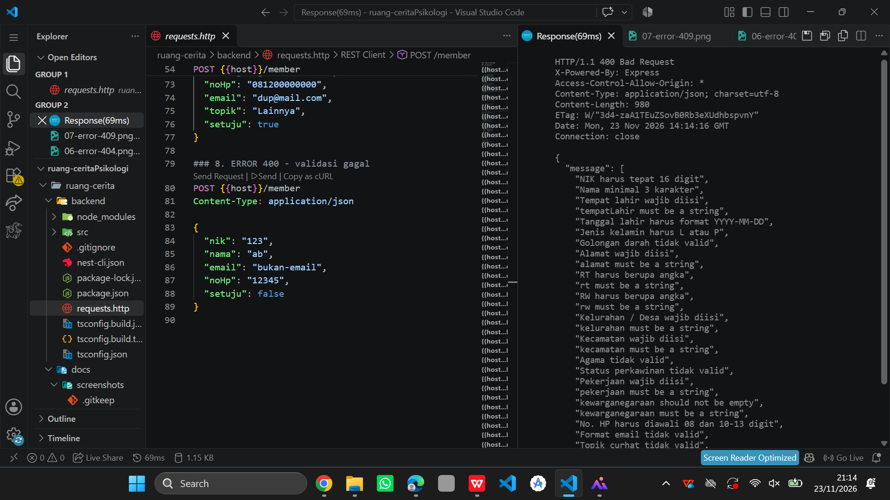
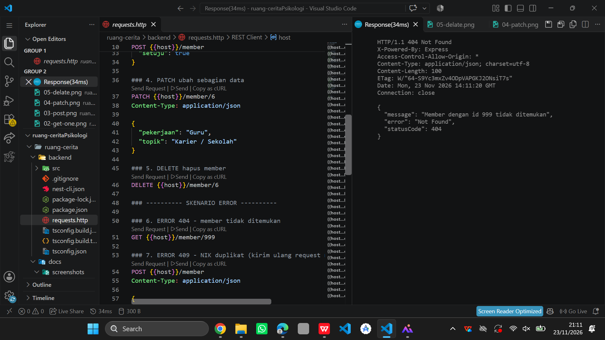
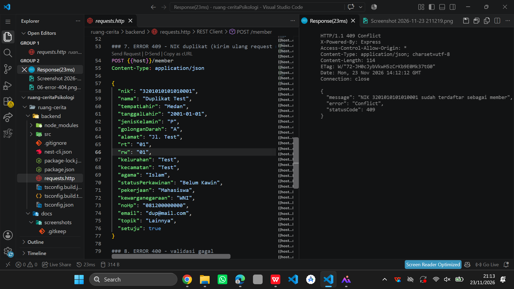
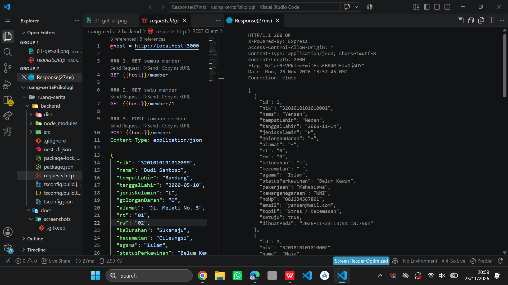
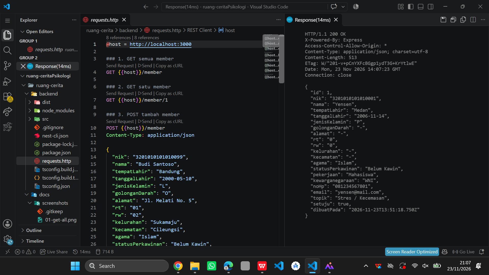
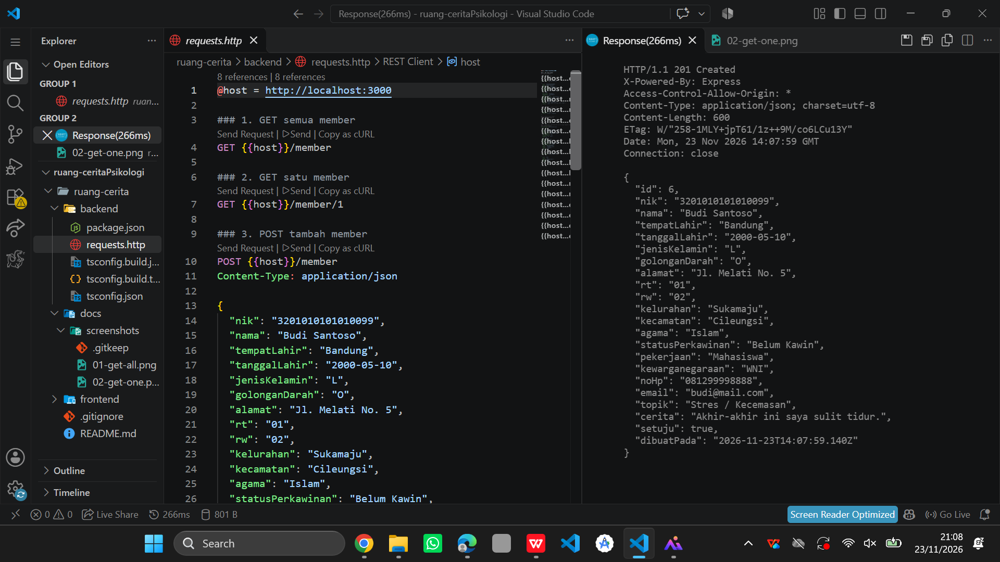
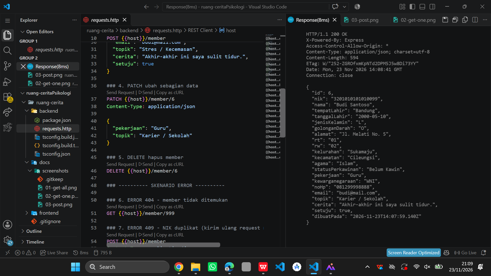
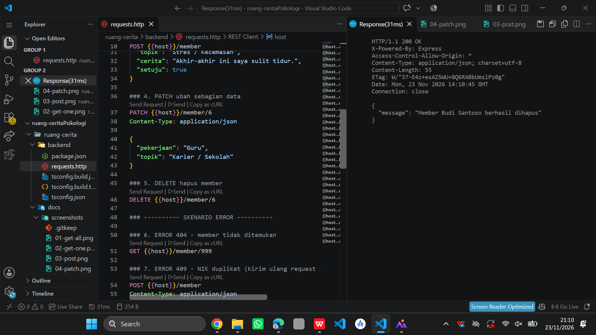

# Ruang Cerita

Website layanan konsultasi dan curhat online bersama psikolog. Proyek fullstack
yang dikembangkan bertahap: tampilan website dibuat sejak pekan 2 (HTML/CSS), dan pada
**Bab 9** ditambahkan **backend NestJS** dengan struktur MVC untuk mengelola
data **Member** (peserta layanan). Frontend dibangun dengan **React** dan terhubung ke backend lewat REST API.

## Struktur Repository
```
ruang-cerita/
├── frontend/            # React (Vite): halaman, komponen, aset
├── backend/             # NestJS: Controller, Service, Entity, DTO
└── docs/screenshots/    # bukti setiap tahapan pengerjaan
```

## Cara Menjalankan
**Backend**
```bash
cd backend
npm install
npm run start:dev      # http://localhost:3000
```
**Frontend** (buka terminal baru, backend harus tetap berjalan)
```bash
cd frontend
npm install
npm run dev            # http://localhost:5173
```
Data disimpan sementara di memori, sehingga kembali ke data awal setiap server restart.

---

# Tahapan Pengerjaan

## 1. Data Utama
Data utama yang dikelola backend adalah **Member**, yaitu data pendaftar layanan
konsultasi sesuai formulir `registrasi.html` dan tabel pada `member.html`.

## 2. Resource dan Entity
Resource dibuat dengan Nest CLI (`nest g resource member`), lalu Entity disesuaikan
dengan formulir pendaftaran. Entity memiliki 22 field dengan tipe yang bervariasi.

| Field | Tipe |
|-------|------|
| id | `number` |
| nik, nama, tempatLahir, alamat, noHp, email, topik, dst. | `string` |
| tanggalLahir | `string` (format tanggal ISO) |
| jenisKelamin | `'L' \| 'P'` (union type) |
| cerita | `string` (opsional) |
| setuju | `boolean` |
| dibuatPada | `Date` |

```ts
export class Member {
  id: number;
  nik: string;
  nama: string;
  jenisKelamin: 'L' | 'P';
  cerita?: string;
  setuju: boolean;
  dibuatPada: Date;
  // ... (field lengkap ada di member.entity.ts)
}
```

<!-- Hapus tanda komentar setelah file gambar ada di docs/screenshots/


-->

## 3. Service (CRUD di Memori)
`MemberService` menyimpan data dalam array `members` dan menyediakan lima operasi:
`create`, `findAll`, `findOne`, `update`, dan `remove`.

```ts
@Injectable()
export class MemberService {
  private members: Member[] = [ /* data awal */ ];
  private nextId = 6;

  create(dto: CreateMemberDto): Member { /* ... */ }
  findAll(): Member[] { return this.members; }
  findOne(id: number): Member { /* ... */ }
  update(id: number, dto: UpdateMemberDto): Member { /* ... */ }
  remove(id: number): { message: string } { /* ... */ }
}
```

<!--

-->

## 4. Controller dan Dependency Injection
Setiap endpoint memanggil Service melalui **dependency injection** di constructor,
tanpa membuat instance sendiri dengan `new`.

```ts
@Controller('member')
export class MemberController {
  constructor(private readonly memberService: MemberService) {}

  @Post()   create(@Body() dto: CreateMemberDto) { ... }
  @Get()    findAll() { ... }
  @Get(':id')    findOne(@Param('id', ParseIntPipe) id: number) { ... }
  @Patch(':id')  update(@Param('id', ParseIntPipe) id: number, @Body() dto: UpdateMemberDto) { ... }
  @Delete(':id') remove(@Param('id', ParseIntPipe) id: number) { ... }
}
```

| Method | URL | Fungsi |
|--------|-----|--------|
| POST | /member | Daftar member baru |
| GET | /member | Semua member |
| GET | /member/:id | Satu member |
| PATCH | /member/:id | Ubah data member |
| DELETE | /member/:id | Hapus member |

<!--

-->

## 5. DTO dan Validasi
DTO dibuat untuk operasi create (`CreateMemberDto`) dan update (`UpdateMemberDto`,
semua field opsional). Validasi memakai `class-validator`, dan `ValidationPipe`
diaktifkan secara global di `main.ts`.

Aturan validasi yang dipakai antara lain:

| Decorator | Dipakai pada |
|-----------|--------------|
| `@Length(16, 16)` dan `@Matches(/^\d+$/)` | NIK harus 16 digit angka |
| `@MinLength(3)` | Nama minimal 3 karakter |
| `@IsDateString` | Tanggal lahir format YYYY-MM-DD |
| `@IsIn([...])` | Jenis kelamin, agama, status, topik |
| `@IsEmail` | Email |
| `@Matches(/^08\d{8,11}$/)` | Nomor HP |
| `@IsOptional` dan `@MaxLength(500)` | Cerita singkat |
| `@Equals(true)` | Persetujuan data |

```ts
// main.ts
app.useGlobalPipes(
  new ValidationPipe({ whitelist: true, forbidNonWhitelisted: true, transform: true }),
);
```

**Bukti validasi: request dengan data tidak valid ditolak (400 Bad Request)**



<!--


-->

## 6. Penanganan Error
Dua skenario error ditangani dengan exception bawaan NestJS:

| Skenario | Exception | Status |
|----------|-----------|--------|
| Member dengan id tertentu tidak ada | `NotFoundException` | 404 |
| NIK sudah terdaftar | `ConflictException` | 409 |

**404 Not Found: member dengan id 999 tidak ditemukan**



**409 Conflict: NIK sudah terdaftar**



## 7. Pengujian dengan REST Client
Seluruh endpoint diuji memakai ekstensi REST Client (file `backend/requests.http`)
sebelum disambungkan ke frontend.

**GET semua member (200 OK)**



**GET satu member (200 OK)**



**POST tambah member (201 Created)**



**PATCH ubah sebagian data (200 OK)**



**DELETE hapus member (200 OK)**



## 8. Koneksi Backend dengan Frontend
Frontend (proyek pekan 2) dibangun ulang dengan **React** dan disambungkan ke backend memakai `fetch`.
Seluruh pemanggilan API dikumpulkan di satu file, `frontend/src/api.js`.

| Halaman React | Fungsi | Endpoint |
|---------------|--------|----------|
| `Pendaftaran.jsx` | Formulir pendaftaran, menampilkan pesan error validasi dari backend | `POST /member` |
| `Member.jsx` | Tabel member, tombol **Ubah** dan **Hapus** | `GET`, `PATCH`, `DELETE /member` |

Struktur frontend:
```
frontend/src/
├── api.js              # semua fetch ke backend NestJS
├── App.jsx             # routing (React Router)
├── components/         # Layout (header, menu, footer), Pesan
└── pages/              # Beranda, Pendaftaran, Galeri, Member, Konsultasi, Artikel
```

Alur penuh yang diuji: **menambah, mengubah, dan menghapus data** member.

<!-- Hapus tanda komentar setelah file gambar ada di docs/screenshots/

**Tambah data**


**Ubah data**


**Hapus data**

-->

---

## Teknologi
NestJS, TypeScript, class-validator, React, React Router, Vite, CSS, fetch API.
